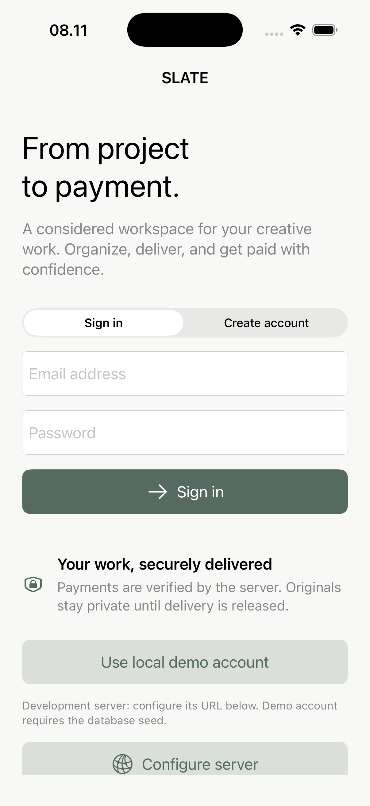
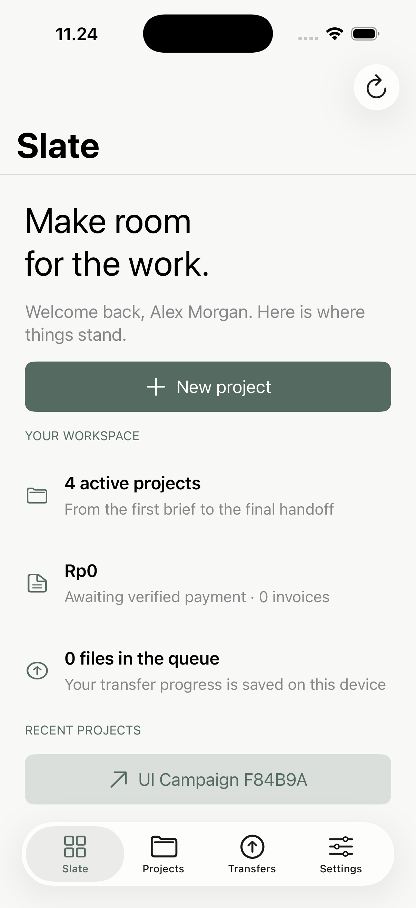
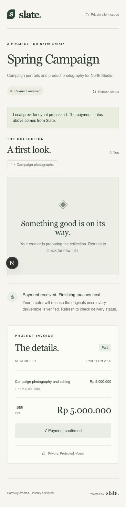
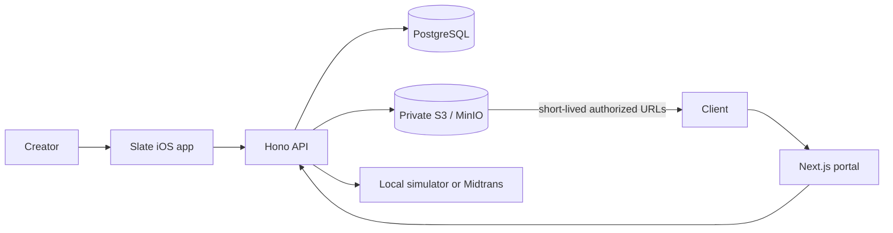

# Slate

**Professional media delivery for independent photographers and creative studios.**

Slate brings client projects, invoices, resilient media uploads, payment verification, and private delivery into one workflow. Its native iOS app is the creator workspace; a small web portal gives each client a private place to review previews, pay an invoice, and download released originals.

| Creator workspace | Project overview | Client portal |
| --- | --- | --- |
|  |  |  |

## Product workflow

1. Create a client and project, then define the expected media deliverables.
2. Issue an IDR invoice. Once issued, its financial details are immutable.
3. Import media from Photos or Files. Slate stages each file locally and uploads it through a resumable multipart queue.
4. Share a capability-based client portal link. Clients can review safe previews and the invoice.
5. Confirm payment through the local simulator or Midtrans Sandbox. The server verifies provider events and records payment state.
6. Release delivery after payment and required file quantities are verified. Clients then receive short-lived download links to the original files.

Payment alone does not release originals. The creator explicitly releases or revokes access from the project in the iOS app.

## Engineering highlights

- **Native iOS:** UIKit, Swift concurrency, Core Data, Keychain, CryptoKit, Photos and Files pickers, and background `URLSession` uploads.
- **Recoverable transfers:** persisted upload state, pause/resume/retry controls, multipart reconciliation with object storage, and server-side size and SHA-256 verification.
- **Authoritative transactions:** Hono API, Prisma, and PostgreSQL enforce invoice, payment, project, and transfer state transitions. Idempotency keys protect retried requests; audit events record important changes.
- **Private delivery:** originals stay in a private S3-compatible bucket. The API checks payment, verified deliverable counts, release state, project ownership, and link validity before issuing a short-lived download URL.
- **Client experience:** Next.js portal with safe image previews, invoice details, checkout, and download controls. Presentation state never grants access by itself.
- **Payment adapters:** a visibly labeled local simulator exercises signed payment-event processing without charging money; Midtrans Sandbox is available when merchant credentials and a public HTTPS webhook are configured.

## Architecture



The iOS app keeps a durable local upload queue and cached project snapshots. The API remains authoritative for payment confirmation, upload verification, and download authorization.

## Run locally

### Requirements

- macOS with Xcode 26 and an iOS 17 or later Simulator runtime
- Node.js 22 or later
- Docker Compose
- XcodeGen only if you need to regenerate the checked-in Xcode project
- Go 1.24 or later only for the optional native MinIO setup

### Start the API and storage

From the repository root:

```sh
docker compose -f infrastructure/docker-compose.yml up -d --build
cd services/api
cp .env.example .env
npm ci
npm run db:generate
npm run db:migrate
npm run db:seed
npm run dev
```

PostgreSQL is exposed on port `55432`; MinIO uses `9000` for S3 and `9001` for its console. Compose builds the pinned MinIO source release, so its first build downloads Go dependencies. See [infrastructure notes](infrastructure/README.md).

### Start the client portal

In another terminal:

```sh
cd apps/client-web
cp .env.example .env.local
npm ci
npm run dev
```

For the local payment simulator, set these values in `apps/client-web/.env.local` and keep the secret identical to `DEV_PAYMENT_SECRET` in `services/api/.env`:

```dotenv
SLATE_API_URL=http://localhost:3000
DEVELOPMENT_PAYMENTS=true
DEV_PAYMENT_SECRET=slate-development-payment-secret-change-me
```

The API's example environment already selects the development payment provider. Restart the API and portal after changing environment values.

### Run the iOS app

Open `apps/ios/Slate.xcodeproj` in Xcode, select the **Slate** scheme, and run it on an iPhone Simulator. The default API address is `http://localhost:3000`; the sign-in screen also provides development server configuration.

The seeded local account is **demo@slate.local** with password **SlateDemo2026!**. Seed data includes a North Studio project and an issued Rp 5,000,000 invoice; it does not create a payment or verified upload.

### Use a physical iPhone on your local network

Configure the API base URL in Slate to the Mac's reachable LAN address. Set `PORTAL_URL`, `API_PUBLIC_URL`, and `S3_ENDPOINT` in the API environment to reachable addresses as well, then set `SLATE_API_URL` in the portal environment to that API address. The phone must be able to reach the API, portal, and S3 endpoint. Restart the affected services after changes.

Local HTTP and development credentials are for a trusted test network only. Use HTTPS and managed secrets for any hosted environment; never expose the development services directly to the public internet.

## Payment modes

### Local simulator

Enable `PAYMENT_PROVIDER=development` and `DEVELOPMENT_PAYMENTS=true` in the API, and enable the portal simulator with the matching server-only `DEV_PAYMENT_SECRET`. The portal calls the API; it never receives the secret. The API signs and processes a development event through the payment handler. This is a test flow and does not move money.

### Midtrans Sandbox

Set `PAYMENT_PROVIDER=midtrans`, add a Midtrans Sandbox `MIDTRANS_SERVER_KEY`, disable `DEVELOPMENT_PAYMENTS`, and configure an externally reachable HTTPS notification endpoint at `/webhooks/midtrans`. Checkout is hosted by Midtrans and webhook signatures are verified by the API. See the [Midtrans notification documentation](https://docs.midtrans.com/docs/https-notification-webhooks). No live payment has been tested or is enabled by this repository's demo configuration.

## Verification

API unit and build checks:

```sh
cd services/api
npm run build
npm test
```

API integration tests require the configured PostgreSQL and MinIO services:

```sh
npm run test:integration
```

Portal checks:

```sh
cd apps/client-web
npm test
npm run check
npm run build
```

iOS Simulator tests:

```sh
xcodebuild -project apps/ios/Slate.xcodeproj -scheme Slate \
  -destination 'platform=iOS Simulator,name=iPhone 17 Pro' \
  CODE_SIGN_IDENTITY=- test
```

The live background multipart test and authenticated UI test are opt-in. See [testing instructions and the latest verification record](docs/TESTING.md). A reproducible walkthrough, including failure and recovery scenarios, is in the [demo guide](docs/DEMO.md).

## Project documentation

- [System architecture](docs/ARCHITECTURE.md)
- [API contract](docs/API_CONTRACT.md)
- [Transaction and payment engine](docs/TRANSACTION_ENGINE.md)
- [Transfer engine](docs/TRANSFER_ENGINE.md)
- [Delivery security](docs/DELIVERY_SECURITY.md)
- [Performance notes](docs/PERFORMANCE.md)
- [Engineering case study](docs/CASE_STUDY.md)

## Scope and limitations

Slate is an engineering MVP for local and sandbox demonstrations, not an App Store release. iOS controls background execution, so force-quitting the app can pause transfers until it is reopened. Image previews are watermarked derivatives; video and PDF previews use metadata placeholders. Physical-device lifecycle testing, Instruments profiling, and merchant-backed Midtrans Sandbox verification require separate test environments. See [the verification record](docs/TESTING.md) for what has and has not been exercised.
