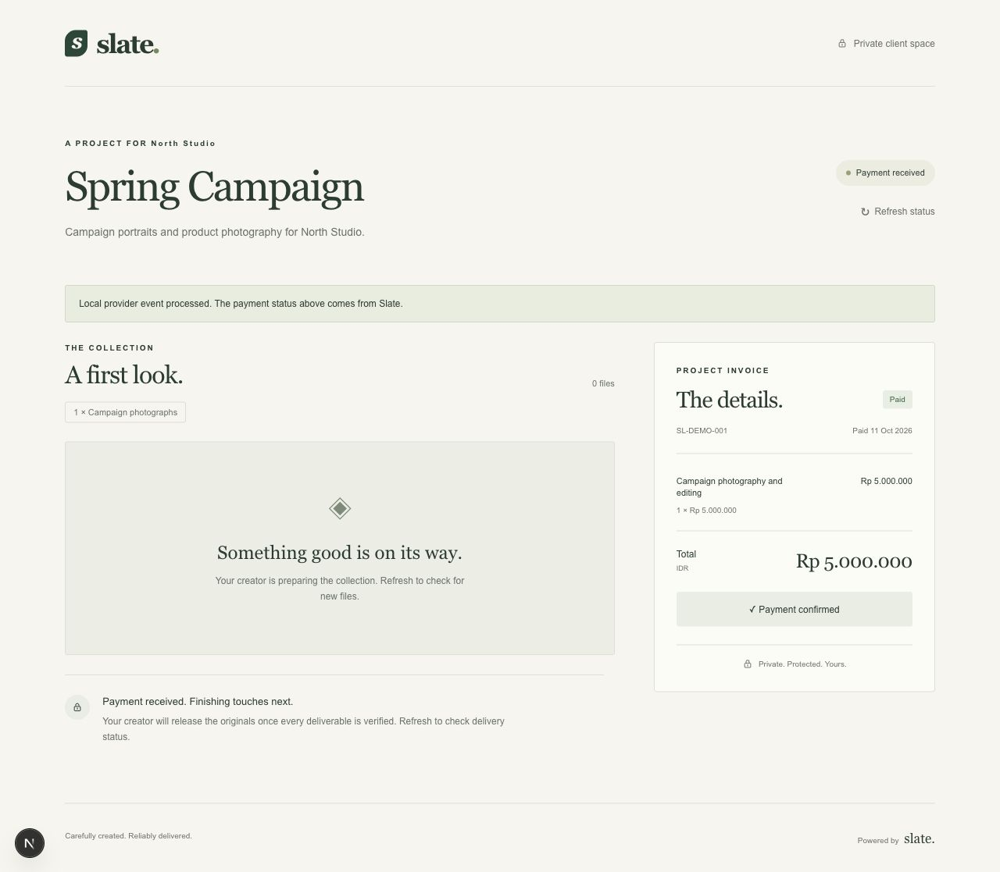

# Slate client portal

A lightweight Next.js / TypeScript client space at `/p/[token]`. The high-entropy share capability is the only credential. No creator login or creator credentials are used here.

## Run locally

Requires Node 20.9+ and the Slate API on `http://localhost:3000`.

```sh
cd apps/client-web
cp .env.example .env.local
npm ci
npm run dev
```

Open the share URL created by the creator API; the portal listens on port 3001. The home page explains where to get a project link. For a production build, run `npm run build` then `npm start`.

## Configuration

`SLATE_API_URL` is the server-side backend origin. All browser requests go to Next route handlers, which forward only the capability to the API. `DEV_PAYMENT_SECRET` stays on the server and must match the backend secret. Never prefix either setting with `NEXT_PUBLIC_`.

For deterministic local payment testing, set `DEVELOPMENT_PAYMENTS=true` on both API and portal and configure `DEV_PAYMENT_SECRET`. After initiating checkout, the portal shows **Local payment simulator** for an outstanding simulator attempt. It asks the API to emit a signed simulated provider event; it never writes invoice state. The handler validates that the attempt belongs to the share capability. Both the control and server handler are disabled when `NODE_ENV=production`, regardless of the flag. Midtrans sandbox checkout redirects to the URL supplied by the API.

## Delivery and security

The gallery displays only the API's safe `previewURL` derivative. Missing previews show a placeholder; originals are never used as thumbnails. Originals have no href in the page. A download request obtains a new short-lived signed URL from the backend, which authorizes payment, verified quantities, release, revocation, and capability validity on every request. UI gating is only presentation.

The page provides authoritative status refresh, invoice line items, loading/error states, and an expired/revoked-link recovery message. Checkout retries use the same idempotency key while the page is open. Same-origin mutation checks, `no-store`, `no-referrer`, no indexing, and framing protection reduce capability leakage. Share links remain bearer credentials: distribute them privately. Previously issued storage URLs remain valid until their short expiry; revocation blocks issuing new ones.

## Verify

```sh
npm test
npm run check
npm run build
```

Tests cover payment/release presentation, production simulator gating, capability-bound simulation, mutation origin, URL navigation safety, and integer IDR formatting. Backend tests own financial state and signed-download authorization. Browser end-to-end verification requires the API, database, object storage, and a seeded project; no external-provider or real-money payment is represented as tested here.

Verified locally on 11 October 2026: eleven tests passed, TypeScript check passed, and Next.js 16.4.0 production build passed. A running production server returned 404 for the simulator even with development flag and secret set, 404 for an invalid capability, and 200 for the home page. `no-store` and `no-referrer` response headers were checked. The home page and unavailable-link state were visually checked in a browser.

The seeded Spring Campaign was also exercised through the actual API: pending IDR 5,000,000 invoice → checkout redirect → labeled local simulation → signed provider event → refreshed paid invoice. Replaying the settlement returned 200 and retained one payment attempt; requesting a final download while deliverables were incomplete returned 403. The 390px mobile layout had no horizontal overflow. The configured development secret was absent from all 47 browser artifacts inspected. Screenshots are saved in `screenshots/` for pending, simulator, paid, and mobile states. This verifies the local simulator, not an external payment provider.


