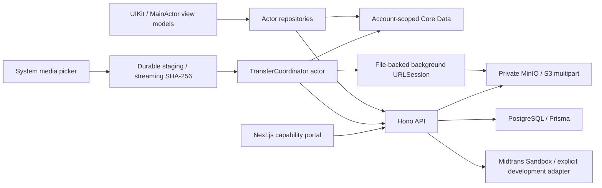

# Architecture

`apps/ios` contains the native app and XCTest/XCUITest targets. `services/api` owns the schema, migrations, domain rules, financial processing, media authorization, and maintenance. `apps/client-web` is a client-facing portal, not a creator administration app. `infrastructure` provides PostgreSQL and source-built MinIO.

UIKit navigation uses native navigation/tab controllers, scrollable forms, grouped tables, sheets, PHPicker, and UIDocumentPicker. Authentication and project list view models own validation/load state. Repository actors own network and cache workflows; dependency injection keeps view controllers separate from persistence and transfer scheduling. Swift values cross actor boundaries; managed objects remain inside the private Core Data queue.

The iPhone is authoritative only for staged bytes, local draft operation keys, upload task mappings, and scheduling preferences. Financial and delivery snapshots are read-only projections. A cached `PAID` status cannot authorize a download: every client download request checks the live database and then issues a private signed URL.

The transfer actor owns two concurrent part slots across the entire queue. Temporary picker references are copied before callback expiry; SHA-256 and file splitting run away from the main actor. App lifecycle callbacks reconnect the persistent background session and restore account-scoped records. Network path recovery triggers synchronization, with durable retry metadata and manual recovery if the OS does not wake the app.

PostgreSQL constraints and serializable transactions/advisory locks protect duplicate requests, state transitions, payment application, and release. External payment/storage operations cannot join a database transaction; durable attempt/session state and repeated maintenance resolve interrupted workflows. See the transaction/transfer documentation for exact recovery boundaries.

Local development uses loopback HTTP; HTTPS is required for deployment. Credentials live in Keychain on iOS and environment variables on the server. Portal capabilities are high entropy, stored hashed, and replayable creation responses are encrypted. Creator tokens never enter the portal.
