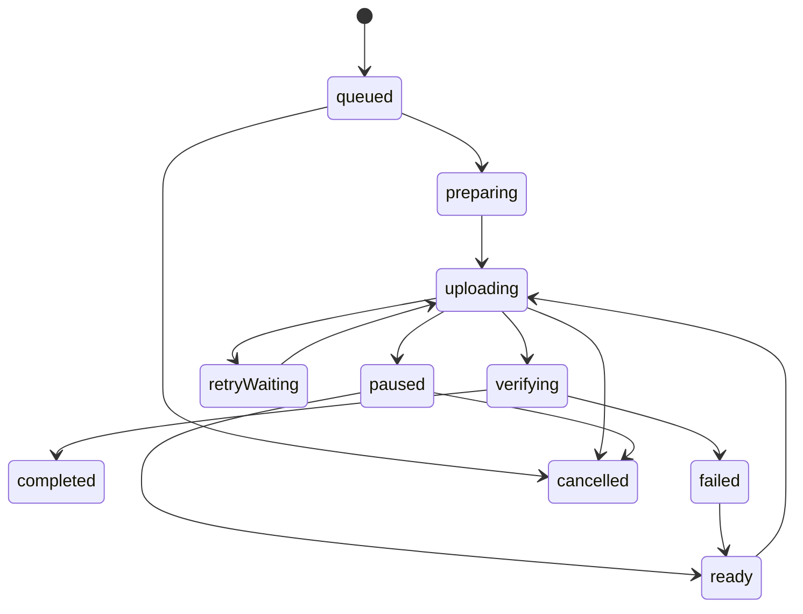

# Durable native media transfers

Slate uploads actual S3 multipart bytes using file-backed background URLSession tasks. The backend coordinates storage sessions and reconciles `ListParts`; a successful PUT alone never makes media deliverable.

## Ownership and persistence

`TransferCoordinator` is the sole queue owner and scheduler. Its actor stores immutable Codable transfer records through `LocalStore`, whose programmatic Core Data schema stores account-scoped blobs. Managed objects remain inside private-context `perform` blocks. Automatic lightweight migration is enabled; database recreation is never used as a recovery strategy. The blob format allows additive optional fields without changing the Core Data schema.

Each record persists the staged source URL, expected streaming SHA-256, backend session, confirmed parts, retry state, and each URLSession task identifier/part file mapping. Create, complete and cancel operations have separate UUID idempotency keys saved before a request. Each task is created suspended, its file mapping is committed, and only then is it resumed. A crash before persistence leaves a suspended orphan task which recovery cancels.

Account activation loads only the authenticated account's records. Startup reconnects to the same session identifier (`com.slate.multipart.background.v1`) and preserves matching tasks. Account switches and logout cancel old tasks and discard the previous in-memory queue; account-scoped staging records stay durable for that owner. Cached projects are also scoped by owner. Offline authentication restoration requires the Keychain token digest to match the saved identity. Creator tokens are stored in Keychain with `AfterFirstUnlockThisDeviceOnly` accessibility, never in Core Data or transfer files.

## Import and bounded memory

PHPicker file representations are temporary. `MediaImporter.copyTemporaryFile` must run synchronously inside the picker callback, before that callback returns. Security-scoped access and coordinated reads create an app-owned staging copy. The UI can then start `inspect`, which hashes in a detached utility task using 1 MiB chunks, extracts ImageIO dimensions without decoding the image, and loads video duration through AVFoundation. Images, video and PDFs are accepted; empty files are rejected. The app does not require full photo-library access.

Staging uses Application Support, excludes files from backup, and uses file protection permitting uploads after the first unlock. Multipart files are written in 1 MiB chunks, bounded to the server-selected part size, using a temporary file followed by rename. Two part tasks may run at once across the entire queue. No whole-video Data upload is used.

## State and recovery

The transition validator rejects terminal-state resurrection. Pausing cancels current tasks rather than keeping all queue slots indefinitely occupied; completed remote parts survive and are discovered through ListParts before another part is scheduled. The UI's progress includes provisional delegate bytes, but only server reconciliation confirms part completion.

Recovery enumerates existing background tasks, matches durable mappings, drops mappings for vanished tasks, and asks the backend for storage state. Unknown tasks are cancelled. Already confirmed parts are skipped. The backend response is validated for total length, part size, unique part numbers and exact per-part length. Two in-flight parts remain the global limit. Delegate events flow through one ordered AsyncStream to the actor, avoiding unrelated tasks mutating the queue concurrently.

Temporary network errors, HTTP 408/429 and storage/server 5xx responses enter persisted exponential backoff with jitter. Retry-After accepts both seconds and HTTP dates and takes precedence over shorter computed waits. Automatic retries stop after six failures without progress. A 403 from a signed storage PUT causes re-signing after reconciliation, preserving completed parts. Backend ownership/authentication errors are permanent; they are never converted into successful uploads. Expired multipart sessions fail with an explicit instruction to cancel and import again.

Completion calls the repeat-safe backend completion endpoint. The backend must complete storage and stream the entire object's SHA-256, including when recovering from a crash between those stages. The iOS record becomes completed only when the returned asset is VERIFIED with matching size and expected content hash. Multipart ETags are never treated as whole-file checksums.

## Cancellation and cleanup

Cancellation is saved locally before aborting storage. If a create response was lost, the coordinator replays its original create key to discover the same logical session before aborting it. An unconfirmed server abort remains visible as a cancellation error and is retried on restoration; source bytes are retained. Part files are deleted only after their task completion event or when restoration proves no corresponding task exists. Sources are deleted only after verified completion or confirmed cancellation and after all task mappings are gone. Failed verification preserves bytes and diagnostics.

The backend is responsible for expiration and stale multipart cleanup. Partial `.tmp` writes or unqueued imports interrupted by process death currently need local retention cleanup; they never become deliverable or masquerade as queued uploads.

## Lifecycle integration

The application delegate forwards the background-session completion closure through the dependency bridge to `handleBackgroundEvents`. It is called on the main actor after the ordered delegate stream reaches its finished-events marker. Queue restoration happens during authenticated startup and foreground refresh.

Background URLSession is controlled by iOS. Task execution can be delayed by connectivity, scheduling and resource policy. Follow-on signing and verification requests require application execution time; background completion alone cannot guarantee an entire large queue drains while suspended. Force quitting can cancel background tasks and prevents automatic relaunch. The next manual launch reconciles storage rather than trusting stale local progress. Cellular uploads are opt-in; policy changes cancel active requests so replacements apply the new policy.

## Verification status

Eight portable engine XCTest cases executed successfully on the macOS host (zero failures, 2026-10-11): terminal transitions, bounded retry/Retry-After, streaming SHA-256 against a known digest and exact multipart slicing, account-isolated Core Data reopening, concurrent upserts, cancellation/auth failure classification, fractional ISO8601 decoding, and persisted task/idempotency mappings. The sources and XCTest files have also been independently typechecked against the Xcode 26 iOS 17 simulator SDK.

An opt-in live XCTest (`SLATE_INTEGRATION=1`) uses a real 17 MiB PDF, backend authentication and real S3 bytes: seed part one, restore a paused durable record whose local progress is stale, reconcile ListParts without retransmitting that part, and upload the remaining two parts through background URLSession. It then checks backend VERIFIED hash/size and safe staging cleanup. This integration fixture registers a separate test creator and leaves that account/project on the development backend. The suite skips this test by default; host unit tests do not validate background iOS networking. Physical-device background delivery, force quit, radio changes and Instruments memory measurements remain separate validation work; no device measurements are claimed here.
